<p align="center">
  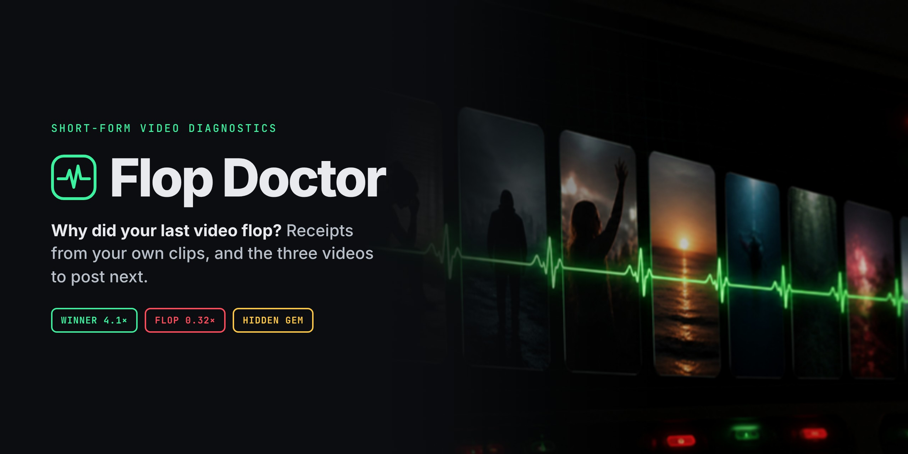
</p>

<p align="center">
  <b>Drop a TikTok or Instagram handle. Find out why your videos flop, with receipts from your own clips.<br>Get the three videos to post this week, written in your voice.</b>
</p>

<p align="center">
  <a href="LICENSE"></a>
  
  
  
  
  <a href="https://github.com/coldrazer/flopdoctor/actions/workflows/ci.yml"></a>
</p>

<p align="center">
  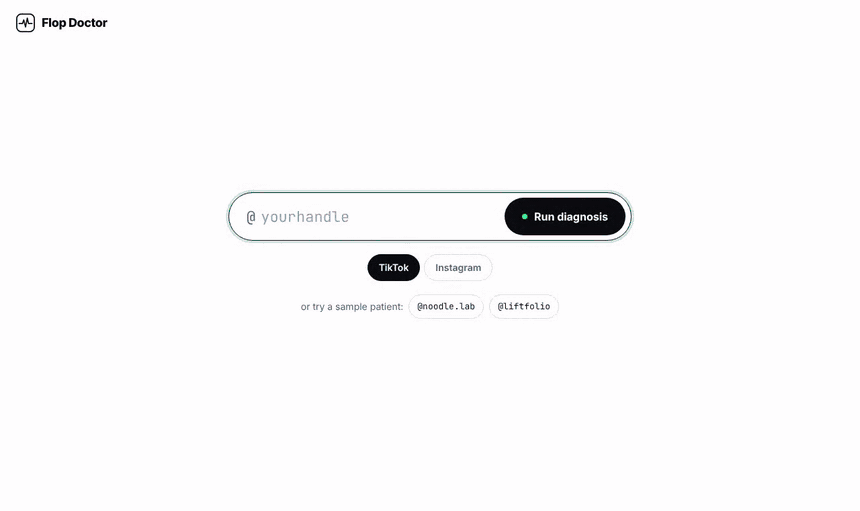
</p>

---

## What it does

Creator analytics tell you *what* flopped. Flop Doctor tells you *why*, and what to post next.

1. **Measures every video against your own median**, not anyone else's. Your median is the flatline; winners spike above it, flops dip below.
2. **Compares your winners to your flops** using what's actually in the videos: the first words spoken, how long until your face appears, length, format and posting time. Every finding cites the clips it came from.
3. **Writes a prescription**: three videos to post this week, with hooks copied from your own best openers and proof from what's working in your niche right now.

Built for **Hack the Feed**, the creator-tools hackathon hosted by Oriane, GMI Cloud and Lovable. Video data comes from [Oriane](https://oriane.xyz), inference runs on [GMI Cloud](https://www.gmicloud.ai), and the app is built to run on [Lovable](https://lovable.dev).

## Contents

- [Screens](#screens)
- [How it works](#how-it-works)
- [Quick start](#quick-start)
- [Deploy on Lovable](#deploy-on-lovable)
- [Console scripts](#console-scripts)
- [How scoring works](#how-scoring-works)
- [Project layout](#project-layout)
- [Testing](#testing)
- [Roadmap](#roadmap)
- [Contributing](#contributing)
- [License](#license)

## Screens

> Screenshots use the built-in sample creators, **@noodle.lab** and **@liftfolio**. They're fictional; every number is made up to show the layout.

### 1 · Intake, then the wheel

Type a handle and the white screen fades into a wheel of the last 20 videos. While the scan runs, Dr. Flop stops the wheel on one clip at a time, explains what went right or wrong, stamps it, and pulls the video so you can watch it.

| Intake | Diagnosing a clip | Video pulled |
|:---:|:---:|:---:|
| 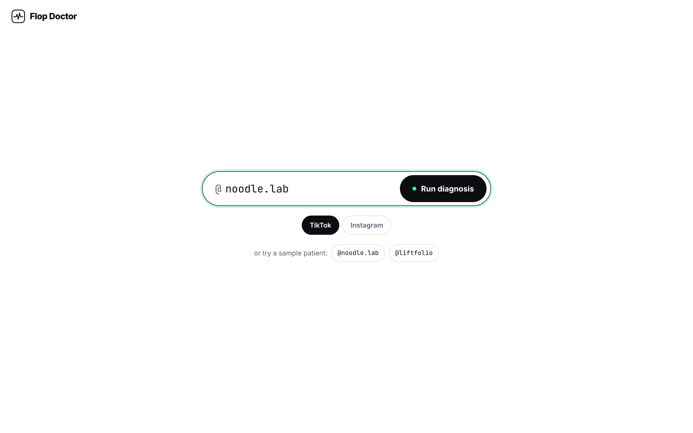 | 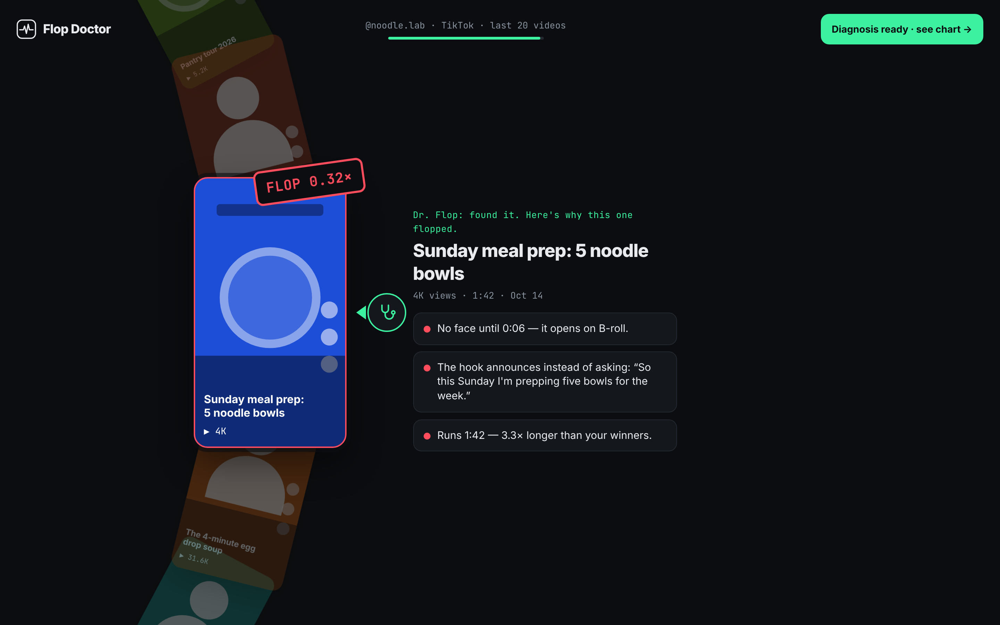 | 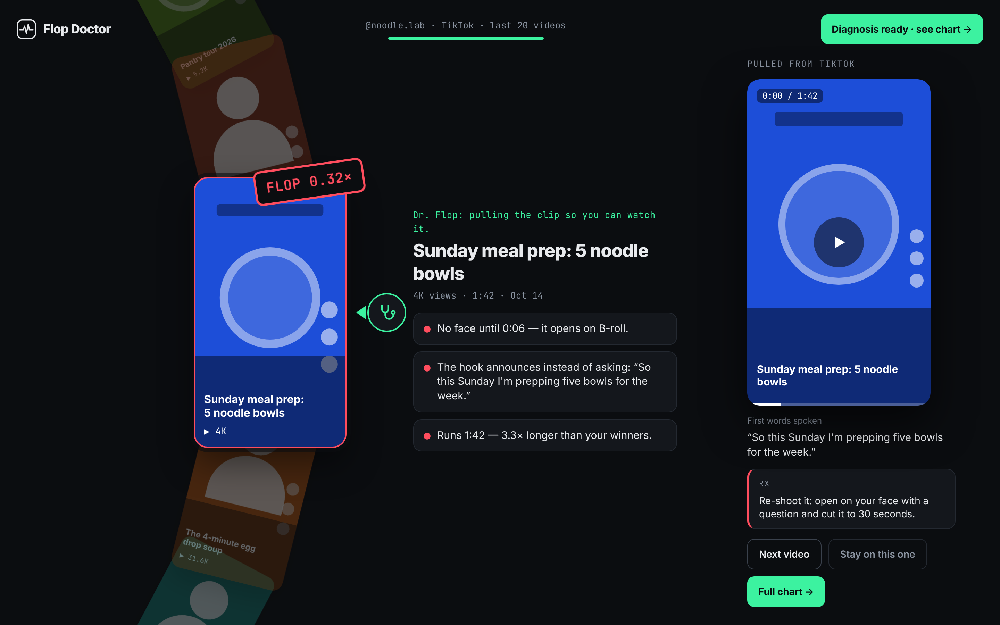 |

### 2 · The diagnosis

The verdict in one sentence, the Vitals chart (every video against your flatline), and 3–5 patterns with clickable evidence from your own clips. Hidden gems, videos with low views but unusually high engagement, get flagged separately: that's a distribution problem, not a content problem.

<p align="center">
  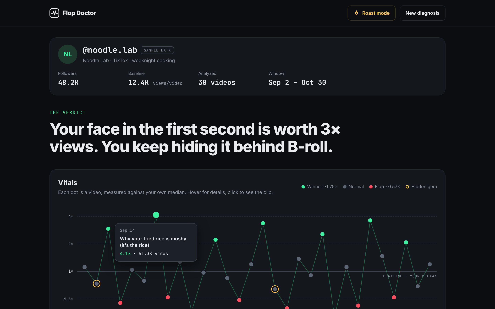
</p>
<p align="center">
  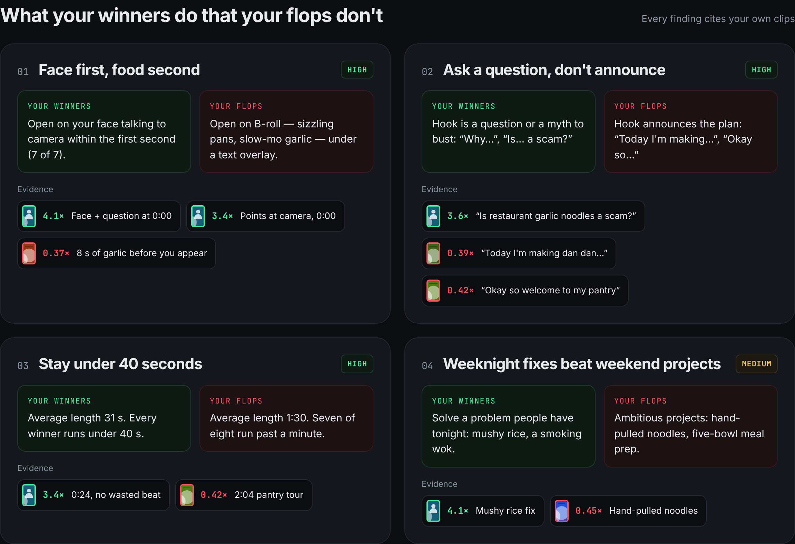
</p>

### 3 · The prescription

Three videos to post this week. Each has a hook in your voice, timed beats, why it works, and proof clips. Copy one hook, or copy all three as a shot list.

<p align="center">
  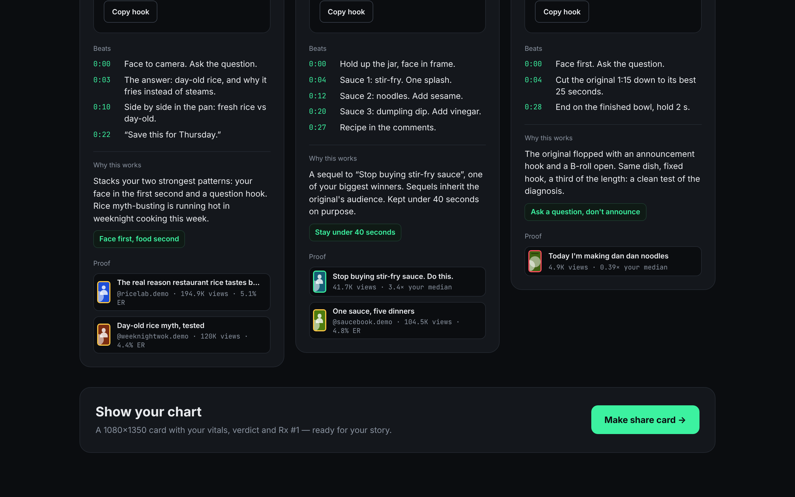
</p>

### 4 · Roast Mode and the share card

Roast Mode rewrites the verdict and pattern titles as a roast of the content (never the person). The share card is a 1080×1350 PNG made for stories.

| Roast Mode | Share card |
|:---:|:---:|
| 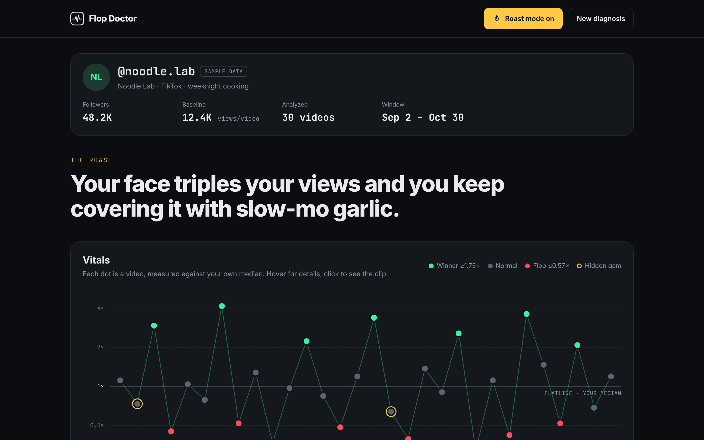 | 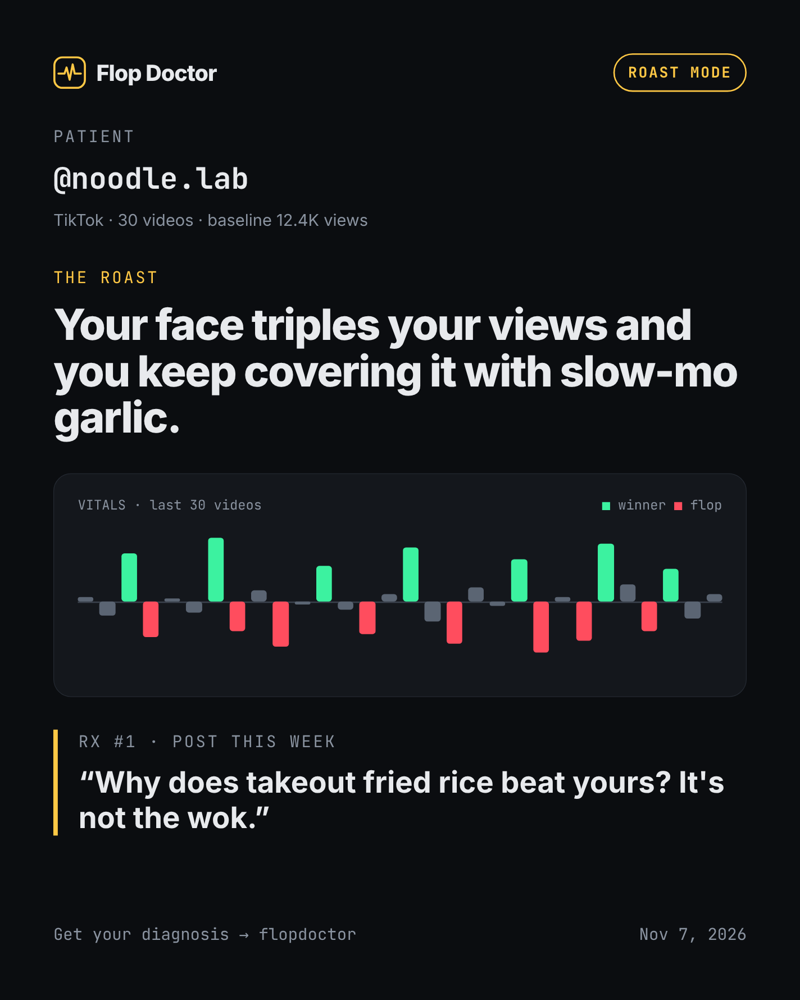 |

### 5 · On a phone

| Intake | Wheel | Pulled video | Chart |
|:---:|:---:|:---:|:---:|
| 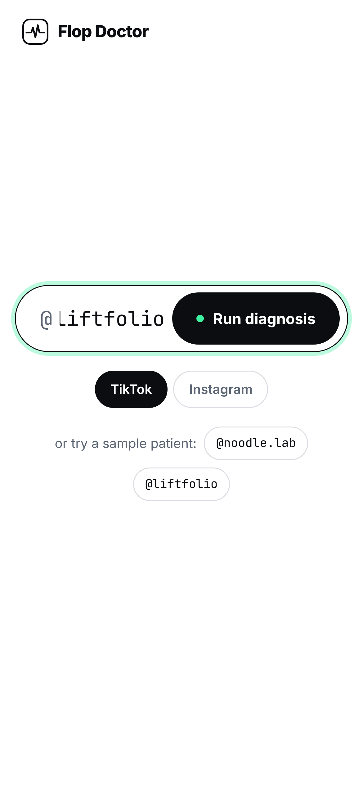 | 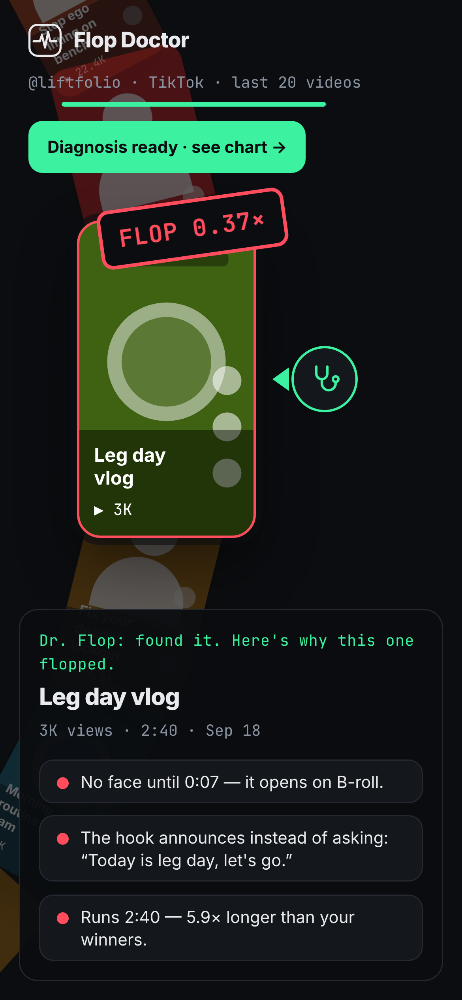 | 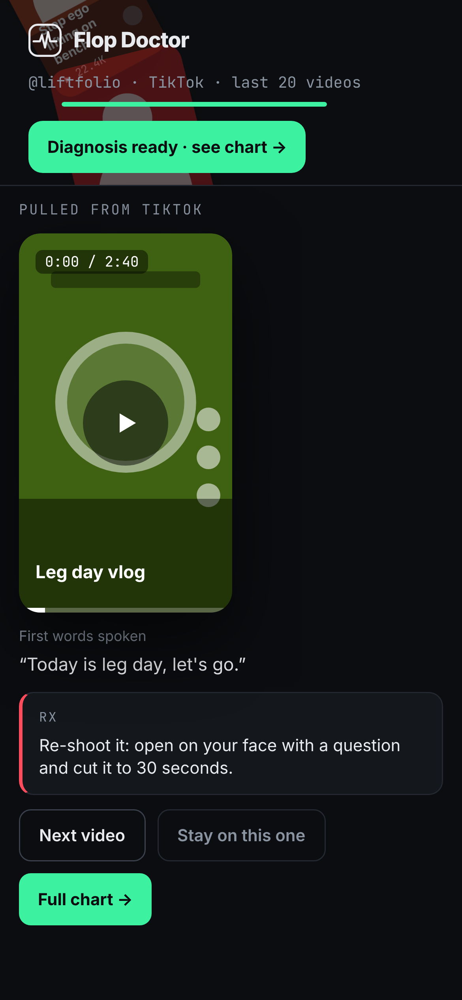 | 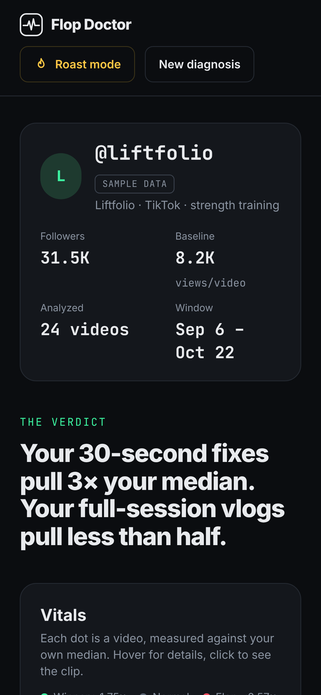 |

## How it works

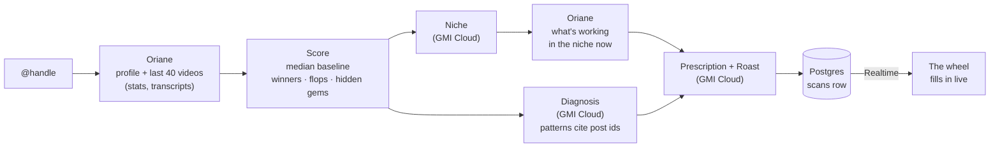

- **One pipeline, three places.** `supabase/functions/_shared/pipeline.ts` runs the whole diagnosis. The `run-scan` Edge Function, the console scripts and the tests all call the same code.
- **Live progress.** `run-scan` inserts a `scans` row, returns right away, and writes each step back to that row. The wheel follows it through Supabase Realtime, with polling as a backup.
- **Nothing is paid for twice.** Every Oriane response is cached in `api_cache` (or `scripts/cache/` for the scripts), and a finished scan of the same handle is reused for 6 hours.
- **The model can't make things up.** It gets a fact table and must cite post ids. Any evidence id that isn't in the input is dropped before it reaches the screen.
- **It still works when the model doesn't.** If the model fails twice, a built-in heuristic diagnosis takes over, using hook type, length, face timing when available, and posting time.

## Quick start

Requires Node 18+. The app runs on the built-in sample data with no keys.

```bash
git clone https://github.com/coldrazer/flopdoctor
cd flopdoctor
npm install
npm run dev        # http://localhost:5173
```

Try **@noodle.lab** or **@liftfolio**. Any other handle shows a sample, clearly labeled "Demo mode", until live data is connected.

### Data modes

| `VITE_DATA_MODE` | What happens |
|---|---|
| `fixture` *(default)* | Sample creators, plus any real scans you've pre-cached into `src/fixtures/live/`. No network. |
| `live` | Calls the `run-scan` Edge Function and follows the scan live. Sample and pre-cached handles still load instantly. Needs `VITE_SUPABASE_URL` and `VITE_SUPABASE_ANON_KEY` (Lovable fills these in). |

## Deploy on Lovable

1. Import this repo into [Lovable](https://lovable.dev) and turn on **Lovable Cloud**.
2. Ask Lovable to apply the pending migration in `supabase/migrations/`.
3. Add these under **Cloud → Secrets**:

   | Secret | Value |
   |---|---|
   | `ORIANE_MODE` | `direct`, or `firecrawl` to go through Firecrawl |
   | `ORIANE_API_KEY`, `ORIANE_BASE_URL` | Your Oriane key and API base URL |
   | `ORIANE_PATH_TEMPLATE` | Optional, defaults to `/v1/{platform}/{capability}` |
   | `FIRECRAWL_API_KEY` | Only for `ORIANE_MODE=firecrawl` |
   | `GMI_API_KEY`, `GMI_MODEL` | Your GMI Cloud key and the model to use |
   | `GMI_MODEL_FAST` | Optional, a faster model for niche detection |

4. Ask Lovable to deploy the edge functions (`run-scan`, `get-scan`).
5. Set `VITE_DATA_MODE=live` and publish.

## Console scripts

Everything runs without the UI, so recurring prep doesn't need the app (or an assistant). Copy `scripts/.env.example` to `scripts/.env` and add your keys. Requires [Deno](https://deno.com).

| Command | What it does |
|---|---|
| `deno task check-handles` | For each handle in `scripts/handles.txt`: is it indexed, how many videos, how fresh, are there transcripts. Marks which handles are safe to demo live. |
| `deno task precache` | Runs the full diagnosis for every handle and saves the results to `scripts/out/`. |
| `deno task export-fixtures` | Turns those results into instant demo creators in the app: real data, no network, no credits. |
| `deno task diagnose @handle` | The whole pipeline in the terminal. Prints a Markdown report and saves it to `reports/`. Add `--platform instagram`, `--roast`, `--offline` (no model) or `--fixture file.json` (no network at all). |
| `npm run screenshots` | Rebuilds the app and recaptures every image in this README, including the GIF. One-time setup: `npm i -D playwright && npx playwright install chromium`. The GIF needs `ffmpeg`. |

## How scoring works

- Videos younger than 72 hours are skipped, since they're still collecting views.
- **Baseline** is the creator's median views. Each video's ratio is its views divided by that median, plotted on a log₂ scale.
- **Winner** is 1.75× the median or more. **Flop** is 0.57× or less. If a very consistent account has fewer than three of either, the top and bottom 20% are used instead.
- **Hidden gem** is a below-median video whose engagement rate is at least one standard deviation above the creator's average.
- Per-clip findings on the wheel come from the data, not the model: hook type (question, announcement, statement or silent), length against the creator's winners, and face timing when Oriane's visual analysis provides it. Without face data, that check is skipped rather than guessed.

## Project layout

```
src/
  screens/            WheelIntake · Diagnosis · Prescription · ShareCard
  components/         ArcWheel (the wheel) · VitalsChart · Thumb
  lib/                data layer (fixture / live), store, video embeds
  fixtures/           sample creators · live/ for exported real scans
supabase/
  migrations/         creators · posts · scans · api_cache, with RLS and Realtime
  functions/
    run-scan/         POST {platform, handle} → {scan_id}, runs the pipeline in the background
    get-scan/         GET ?id → the scan
    _shared/          used by the app, the Edge Functions and the scripts
      pipeline.ts     the whole diagnosis
      scoring.ts      median baseline, labels, hidden gems
      findings.ts     per-clip findings for the wheel
      oriane.ts       Oriane client (direct or via Firecrawl) with caching
      gmi.ts          GMI Cloud client (OpenAI-compatible, JSON out)
      prompts.ts      prompts and validators that drop invented evidence
      heuristics.ts   the no-model diagnosis
scripts/              check-handles · precache · export-fixtures · diagnose · screenshots
docs/                 README images
```

## Testing

```bash
npm test                 # scoring and findings (Vitest)
deno task test:backend   # the full pipeline against a fake Oriane and a fake model
npm run typecheck
```

The backend tests cover the full pipeline with and without the model, the fallback when the model returns junk, dropping invented evidence, unindexed handles, and the cache (a second run makes no network calls). All of it runs on every push and pull request in [CI](.github/workflows/ci.yml).

## Roadmap

- **Agency mode.** Paste ten handles and see who's in a slump, with each creator's top fix.
- **Monday check-up.** A weekly diagnosis for every creator you follow.
- **Hook lab.** Paste a draft hook and score it against your own winners before you film.

## Contributing

Issues and pull requests are welcome. See [CONTRIBUTING.md](CONTRIBUTING.md) for setup and checks, and [SECURITY.md](SECURITY.md) to report a vulnerability privately.

## Notes

- Flop Doctor only reads public videos and never posts to an account.
- Not affiliated with or endorsed by TikTok, Instagram or Meta.
- The banner art was generated with AI.

## License

[Apache License 2.0](LICENSE)
